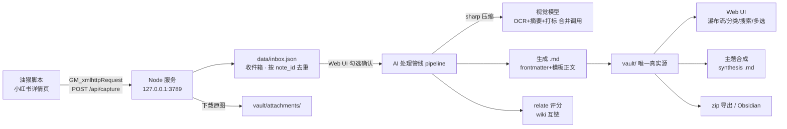

# 薯藏 RedVault · 设计文档

> 小红书内容抓取与个人知识管理工具 · MVP 版
> 版本：v1.0（2026-09-07）· 状态：已评审定稿，指导实现

---

## 1. 项目概述

### 1.1 一句话定位

浏览小红书时**自动捕获**帖子完整内容，经 **AI 整理**（OCR / 摘要 / 两级分类 / 排版）沉淀为本地 **Markdown 知识库**，并通过**主题合成**与**笔记互链**把收藏变成可用的知识，而非只进不出的囤积。

### 1.2 核心价值闭环

```
收（浏览即捕获）→ 整（AI 管线）→ 存（Markdown vault）→ 连（互链推荐）→ 用（主题合成）
```

### 1.3 设计原则

| 原则 | 含义 |
|------|------|
| 零 token 采集 | 抓取只存原始 JSON 进收件箱，用户确认后才触发 AI，不浪费一分钱 |
| vault 为唯一真实源 | 笔记/图片全部落 Markdown 文件夹，工具状态走侧车 JSON，随时可被 Obsidian/Cursor 接管 |
| 原帖不可变 | AI 生成内容与原帖正文严格分区，附件/合成都只追加区块 |
| 本地优先 | 数据、apiKey 全部留在本机，服务只绑定回环地址 |

---

## 2. 总体架构



三段式：**油猴脚本采集 → 本地 Node 服务（处理 + 托管 UI）→ Markdown vault（存储）**，vault 之上叠加利用层（合成 + 互链）。

---

## 3. 技术选型

| 层面 | 选型 | 理由 |
|------|------|------|
| 后端 | Node.js ≥18 + Express 4 | 零构建、生态成熟；仅本机回环监听 |
| 存储 | 纯文件（Markdown + 侧车 JSON） | 无数据库依赖，vault 可直接被外部工具消费 |
| 前端 | 原生 HTML/CSS/JS（无框架、无 CDN 依赖） | 无构建链，Node 静态托管即用；Markdown 由服务端解析，前端只做 `esc()` 转义后渲染 |
| 采集 | Tampermonkey user.js + `GM_xmlhttpRequest` | 读 `__INITIAL_STATE__` 零风控；GM 请求绕过跨域 |
| AI | OpenAI 兼容 REST，双模型槽位（文本 + 视觉） | 兼容 GLM/Qwen/GPT 等任意中转，视觉模型兼任 OCR |
| 图片 | sharp | 压缩 + 缩略图，win32-x64 有预编译；缺失时降级原图 |
| PDF | pdf-parse | 纯 JS 提取文本 |
| frontmatter | gray-matter + js-yaml | 标准 YAML 头读写 |
| 导出 | archiver | zip 流式生成，不整库载入内存 |

---

## 4. 目录结构

```
20260907154022/
├── package.json
├── server/
│   ├── index.js                  # Express 入口：安全中间件、路由挂载、启动自检、统一错误处理
│   ├── routes/                   # capture / inbox / notes / synthesize / attachments / settings / export
│   ├── services/                 # ai / pipeline / relate / synthesize / vault / store
│   └── lib/                      # capture-normalize（payload 规范化）· source-link（溯源 token）
│                                 # http-error（统一 HttpError）· origin-guard（同源校验）· ratelimit（限流）
├── public/
│   ├── index.html                # SPA 外壳（只引 styles.css + app.js + 字体）
│   ├── app.js                    # hash 路由、全局状态、API 封装、视图渲染函数
│   └── styles.css                # 全部自定义样式（无 Tailwind/CDN）
├── userscript/
│   ├── xhs_capture.user.js
│   └── README.md
├── docs/DESIGN.md                # 本文档
├── F:\work\vault\                # 知识库（vaultPath 可配置为外部绝对路径，当前实例）
│   └── attachments/
└── data/                         # 侧车状态
    ├── inbox.json
    ├── config.json
    └── notes_index.json
```

> 注：设计早期设想的 `public/views/` 子目录与 Tailwind/lucide/marked CDN 均未落地，实现为单文件 `app.js` + 手写 CSS。

---

## 5. 模块详细设计

### 5.1 油猴脚本 `xhs_capture.user.js`

**触发**：`@match https://www.xiaohongshu.com/explore/*` 与 `/discovery/item/*`；hook `history.pushState` / `popstate` + URL 轮询（1s）双保险监听 SPA 路由切换。

**数据提取（详情页，零请求）**：

```
window.__INITIAL_STATE__.noteData.noteDetailMap[noteId].note
├── noteType: 'normal' | 'video'
├── title / desc（正文全文）/ tagList
├── user: { nickName, userId }
├── interactInfo: { likedCount }
├── time（发帖时间戳 ms）
├── imageList: [{ urlDefault（无水印）, width, height }]
└── video: stream.media.stream.h264[0]（仅记录，MVP 不转写）
```

字段缺失时做多路径容错（`note.noteData` 结构随版本略有差异），全部缺失则面板报「未找到页面数据」。

**评论抓取（页面上下文内，同源 fetch）**：

- 端点：`GET https://edith.xiaohongshu.com/api/sns/web/v2/comment/page?note_id={id}&cursor={cursor}`（以实际版本为准，脚本内对 404/403 做端点降级尝试）
- 限速：每请求间隔 3000–5000ms 随机抖动；单页失败重试 1 次
- 目标条数：默认 Top 20（GM_setValue 面板可改 10/20/50），按 `like_count` 降序取前 N
- 评论风控触发（连续失败/返回空）→ 放弃评论，主数据照常上报，面板标注「评论未抓取」

**上报**：`GM_xmlhttpRequest POST http://127.0.0.1:3789/api/capture`，header `X-Capture-Token`；响应 409（重复）时面板显示「已在收件箱/已入库」。

**v0.4 演进（收藏夹清单模式，当前主路径）**：`@match` 放宽到 `xiaohongshu.com/*`，hook fetch/XHR 只读吸收收藏列表接口响应（`note_id + xsec_token` 清单），面板驱动自动滚动翻页抓全量；正文/字幕/图片改由服务端 `POST /capture/list` 凭 token 抓详情页完成（限速 1.5~3s 抖动），上报前 `POST /capture/check` 增量过滤。**溯源链接续期**：小红书 `xsec_token` 约数天过期（过期后点「溯源原帖」跳登录/扫码页），check 携带 token 识别 stale、list 对已入库笔记仅刷新 frontmatter `url` 一行——重扫一次收藏夹即可复活全部链接，正文与备注不动。

**悬浮面板**（右下角，小红书红描边小卡片）：

- 状态机：`待检测 → 已提取主数据 → 评论抓取中 3/20 → 已上报 ✓ / 重复跳过 / 服务未启动`
- 服务连通性探测失败时显示「请先启动薯藏服务」并保留数据待重试（同一笔记 60s 内自动重试 3 次）
- 可折叠、可拖动、位置 GM_setValue 记忆

**去重**：脚本侧同 note_id 会话内不重复上报 + 服务侧 inbox/index 双重判重。

### 5.2 Node 服务 `server/index.js`

- Express 4，监听 `127.0.0.1:3789`（`PORT` 环境变量可改）；静态托管 `public/`
- 统一错误响应：`{ error: { code, message } }`
- 请求体上限 5MB（附件上传走 multer 单独 20MB 限制）
- 启动时自检：vault/data 目录创建、config 默认值写入、sharp 可用性检测（日志提示降级）

### 5.3 数据层 `services/store.js`

三个侧车 JSON，全部**原子写**（写 tmp → rename），读时容错（损坏则备份后重建空结构）。

**`data/inbox.json`**（收件箱条目数组）：

```json
{
  "note_id": "65f2a...",
  "captured_at": "2026-09-07T10:00:00+08:00",
  "status": "pending",
  "raw": {
    "type": "normal",
    "title": "...", "desc": "...",
    "author": "昵称", "author_id": "...",
    "published_at": "2026-08-30T12:00:00+08:00",
    "liked_count": 1203,
    "cover_url": "https://...",
    "image_urls": ["https://..."],
    "video": { "duration": 0, "cover": "https://..." },
    "tags": ["减脂", "食谱"],
    "comments": [{ "content": "...", "likes": 532, "author": "...", "time": "..." }],
    "comments_truncated": false,
    "source_url": "https://www.xiaohongshu.com/explore/65f2a..."
  },
  "process": null
}
```

`status`: `pending | processing | done | failed`；`process`: `{ stage, error, started_at, finished_at }`。

**`data/config.json`**：

```json
{
  "ai": {
    "text":  { "baseUrl": "https://api.example.com/v1", "apiKey": "sk-...", "model": "gpt-4o-mini", "priceIn": 0, "priceOut": 0 },
    "vision":{ "baseUrl": "...", "apiKey": "...", "model": "glm-4v-plus", "priceIn": 0, "priceOut": 0 }
  },
  "ocr": { "enabled": false, "lang": "chi_sim+eng" },
  "capture": { "token": "随机生成的上报令牌" },
  "rag": { "provider": "auto", "allowRemoteEmbed": true, "topK": 6, "chunkSize": 700, "chunkOverlap": 80, "rerank": true },
  "review": { "recentDays": 14, "randomSize": 3 },
  "vaultPath": "vault"
}
```

读路径全部走 **mtime 感知缓存**（键 = `mtimeMs + size`）：写盘后立即回填缓存，保证「写后立即可见」；
外部工具（Obsidian）改动文件后靠 mtime 变化自动失效。`commentCount` 随评论抓取下线已移除（M7）。

**`data/notes_index.json`**（内存索引的持久化）：

```json
{
  "notes": [{
    "note_id": "...", "file": "文件名.md", "title": "...",
    "category": "健康", "subcategory": "减脂饮食",
    "tags": ["减脂"], "type": "normal",
    "published_at": "...", "collected_at": "...", "created_at": "...", "modified_at": "...",
    "cover": "attachments/xxx-thumb.webp", "liked_count": 1203,
    "has_attachment": false, "related": ["..."], "sources": []
  }]
}
```

启动时若 index 与 vault 实际文件不一致，以 vault 扫描重建（frontmatter 为准）。
实现为 `vault.reconcileIndex({ store, vault })`（M7）：先比对 `.md` **文件名集合**（避免每次启动全量读盘），
一致则跳过；出现「vault 新增 / index 指向已删除文件 / index 为空而 vault 非空」才全量重建并输出统计日志。

### 5.4 AI 服务 `services/ai.js`

- `chat(slot, messages, { json, maxTokens, temperature })` → POST `{baseUrl}/chat/completions`
- 视觉消息：`image_url: { url: "data:image/jpeg;base64,..." }`
- 重试：429/5xx/网络错误指数退避（2s/4s/8s）共 3 次
- JSON 输出：优先 `response_format: {type:"json_object"}`（不支持时降级），解析失败用「提取首个 `{...}` 平衡括号」兜底，再失败计一次重试
- 成本估算：`(chars/1.6)` 估 token，`priceIn/Out` 可选填单价；每次调用累计入内存计数器，`/api/pipeline/status` 一并返回本次会话累计成本

### 5.5 处理管线 `services/pipeline.js`

逐条串行处理（并发 1，控成本 + 稳定），每条为状态机：

```
pending → downloading_images → ai_processing → relating → writing → done
                     └─────────────── 任一阶段失败 → failed(stage, error)，inbox 条目保留可重试
```

1. **downloading_images**：Node 端 fetch 原图（带 `Referer: https://www.xiaohongshu.com`），存 `attachments/{note_id}-{seq}.jpg`；sharp 生成 `{note_id}-thumb.webp`（300px 瀑布流缩略图）。失败 → 保留外链，frontmatter 记 `images_remote`
2. **ai_processing**：
   - 有图：sharp 压缩（长边 1280、质量 0.8）转 base64，视觉模型**一次合并调用**完成 OCR×N + 摘要 + 两级打标 + 标签 + 评论洞察（结构化 JSON，见 §9 P1）；图片 > 6 张时分批（每批 6 张，结果合并）
   - 有图但 vision 未配置且本地 OCR 开启（设置页「本地 OCR」开关，`ocr.enabled`）：tesseract.js（chi_sim+eng，语言数据缓存 `data/ocr-cache`）逐图提取文字 → 文本模型按 P1L 整理（ocr 字段直供本地结果，AI 只做摘要/打标）——**免 vision 费用**；识别失败自动降级 P2，不阻塞
   - 无图（含视频笔记）：文本模型处理标题+正文+简介+评论（P2），视频笔记明确标注「视频未转写，内容基于简介与评论」
3. **relating**：调 `relate.js` 评分（§5.7）
4. **writing**：渲染模板 → vault 落盘 → 更新 index → inbox 条目置 `done` 并移除（`done` 记录留 log 摘要）

失败重试从失败阶段续跑（图片已下载的不重复下载）。

### 5.6 vault 服务 `services/vault.js`

- **文件命名**：`{标题去非法字符，截断50}.md`，重名追加 `-2`；合成笔记 `合成 · {主题}.md`
- **frontmatter 读写**：gray-matter；`modified_at` 在任何写操作时更新
- **区块定位**：以 `## 🧠 AI 摘要` 等 HTML 注释锚点包裹区块（`<!-- sec:summary -->`），备注/标签编辑时仅替换目标区块，其余内容不动
- **图片下载与缩略图**：见 §5.5；`cover` 字段指向缩略图，`images` 指向压缩后本地文件
- **重命名/删除**：删除笔记同时清理其 attachments 引用计数为 0 的图片

### 5.7 关联评分 `services/relate.js`

对 index 中全部其他笔记评分：

```
score = 3 × |tags ∩ tags'|                 // 标签重合（主信号）
      + 2 × (subcategory 相同 ? 1 : 0)
      + 1 × (category 相同 ? 1 : 0)
      + min(2, 标题 bigram 重合数)           // 中文无分词，2 字符滑窗
```

取 `score > 0` 的 Top 3–5；输出 `related: [note_id...]` 写入 frontmatter，同时在正文「相关笔记」区块生成 `[[文件名]]` wiki 链接列表（Obsidian 图谱可见）。**单向写入**：只改当前新笔记，不回写旧文件。

### 5.8 主题合成 `services/synthesize.js`

- 输入：`{ noteIds: [...], theme?: string }`（≥2 篇）
- **上下文组装**（控 token）：每篇取 frontmatter（title/category/tags）+「AI 摘要」+「关键要点」区块；单篇上限 1500 字、总量上限 30000 字，超限截断并在结果中标注；prompt 见 §9 P4
- 输出 Markdown → 落盘 synthesis 笔记：`type: synthesis`、`sources: [note_id...]`、`related = sources`、tags 由 AI 提炼、无 url/author 等帖子字段
- 合成笔记进 index，可再次被勾选参与合成（嵌套）

### 5.9 附件 `routes/attachments.js`

- **上传**：multer 内存 → 白名单（md/txt/jpg/png/webp/pdf）+ 20MB 限制 → 存 `vault/attachments/{note_id}-att{n}-{原名}`
- **解析**：md/txt 直接读文本（UTF-8，解码失败尝试 GBK）；pdf → pdf-parse；图片 → 压缩后走视觉模型提取要点
- **AI 合并**（P3）：输入 = 原帖「AI 摘要 + 关键要点」+ 附件文本 → 输出「📎 补充材料 N：{附件名}」区块（附件要点 / 与原帖的关联、补充、矛盾点）→ 追加至「补充材料」区块末尾；同时微调「AI 摘要」区块（整体替换，原帖正文永不改写）；`has_attachment` 置真
- 合并可回滚：删除该附件区块即可（UI 提供移除按钮，同步删 frontmatter 附件清单）

### 5.10 导出 `routes/export.js`

archiver 将 vault 全部内容（.md + attachments）流式写入响应 `attachment: redvault-{date}.zip`。

---

## 6. API 契约

统一前缀 `/api`；除 capture 外均同源调用。

| 方法 | 路径 | 说明 | 请求 → 响应要点 |
|------|------|------|----------------|
| POST | `/capture` | 脚本上报（header `X-Capture-Token`） | `{...raw}` → `201 {note_id}` / `409 重复` / `401 token 错误` |
| POST | `/capture/check` | 增量查询：上报前先问哪些需要报（判重口径同 /capture/list 单一事实源 `classifyNote`） | `{items:[{note_id,xsec_token}]}`（≤1000；旧 `{note_ids}` 兼容）→ `{fresh:[新+failed 重采], stale:[已入库但库内 token 过期], total, skipped}`；stale 并入上报以续期链接；旧服务端（只认 note_ids）→ 脚本自动降级全量 |
| POST | `/capture/list` | 收藏夹清单批量上报：服务端逐条抓详情页（限速抖动、瞬时失败补抓一次）后入箱；failed 豁免判重重采；已入库笔记若清单 token 较新 → 仅刷新 frontmatter `url` 续期溯源链接（不动正文/备注） | `{notes:[{note_id,xsec_token,title,...}]}`（≤20/批）→ `201 {results:[{note_id, status: inbox\|failed\|duplicate\|refreshed\|invalid}]}` |
| GET | `/inbox` | 收件箱列表（含 status/process） | → 条目数组（raw 裁剪 desc 至 200 字） |
| GET | `/inbox/:id` | 完整预览 | → 单条完整 raw |
| DELETE | `/inbox/:id` | 删除单条 | → `204` |
| DELETE | `/inbox` | 一键清空 pending | → `204` |
| POST | `/inbox/confirm` | 确认处理 `{ids:[...]}` | → `202`，管线后台逐条跑 |
| GET | `/pipeline/status` | 管线进度 | → `{queue:[{note_id,stage,status,error}], failed:[最近失败条目], failedTotal, sessionCost, tokens}` |
| GET | `/notes` | 列表（全量 index 元数据） | → 卡片数组（不发正文）；**筛选/搜索/排序在前端内存完成**，服务端不做分页过滤 |
| GET | `/notes/:id` | 详情 | → frontmatter + 全文 + 解析好的锚点区块（`sections`） |
| GET | `/notes/:id/link-status` | 溯源链接活性探测（惰性单篇） | → `{status: alive\|expired\|deleted\|error\|no_token, message, cached}`；带分级 TTL 缓存，`?refresh=1` 绕过 |
| PATCH | `/notes/:id/section` | 编辑单个锚点区块 | `{key, content}`，key 白名单 `summary/points/body/ocr/comments/related/attachments/remark` → 只替换该区块 |
| POST | `/notes/:id/reprocess` | 重新打标 | 无 `mode` 参数：重跑 AI 管线并覆盖 AI 区块与分类标签（保留手写内容与评论精选） |
| DELETE | `/notes/:id` | 删除笔记 | → `204`（含孤立附件清理） |
| POST | `/synthesize` | 主题合成 | `{noteIds:[≥2], theme?}` → `201 {note_id}`（同步等待生成，前端显示进度） |
| POST | `/notes/:id/attachments` | 上传附件（multipart） | → `201 {attachment}` |
| GET | `/notes/:id/attachments` | 附件列表 | → `[{id,name,type,size,merged}]` |
| POST | `/notes/:id/attachments/:fid/merge` | AI 合并 | → `201` 区块已追加 |
| DELETE | `/notes/:id/attachments/:fid` | 移除附件及区块 | → `204` |
| GET | `/settings` | 读配置 | apiKey 脱敏 `sk-***abc`；capture token 只回掩码 `rv_***abcd` |
| PUT | `/settings` | 写配置 | 掩码/空值视为未修改；写入前校验路径（拒绝 `..` 穿越） |
| POST | `/settings/test` | `{slot:"text"\|"vision"}` | 发一条最小消息测连通，返回耗时与模型名（限流 10 次/分） |
| POST | `/settings/token/reveal` | 揭示 capture token | → `{token}`（唯一获取明文的入口） |
| POST | `/settings/token/rotate` | 轮换 capture token | → `{token}`；旧油猴脚本需重新填写 |
| GET | `/stats` | 侧栏统计 | → `{inboxCount, noteCount, categoryTree, tagCloud}` |
| GET | `/export` | 导出 zip | → stream |

---

## 7. 数据契约（frontmatter 全字段）

| 字段 | 类型 | 来源 | 说明 |
|------|------|------|------|
| title | string | 帖子/AI（synthesis） | |
| url | string | 抓取 | 溯源链接，synthesis 无 |
| note_id | string | 抓取/AI 生成（synthesis 用 `syn-` 前缀+时间戳） | 全局主键 |
| author / author_id | string | 抓取 | synthesis 无 |
| published_at | datetime | 抓取 | 发帖时间 |
| collected_at / created_at / modified_at | datetime | 系统 | |
| category / subcategory | string | AI | 两级分类 |
| tags | string[] | AI（3–5 个） | |
| liked_count | int | 抓取 | |
| cover | path | 系统 | 指向本地缩略图；下载失败为外链 |
| images | path[] | 系统 | 本地化图片；失败补 `images_remote` |
| type | `normal \| video \| synthesis` | 系统 | |
| related | string[] | relate 评分 | 相关笔记 |
| sources | string[] | 合成 | 仅 synthesis：来源笔记 |
| attachments | string[] | 上传 | 附件文件名清单 |

---

## 8. 笔记模板

**普通笔记**（区块顺序固定，锚点注释包裹，UI 依锚点定位编辑）：

```markdown
---
（frontmatter，见 §7）
---

## 🧠 AI 摘要
> 200 字以内，忠于原帖，含关键结论与适用条件。

## 🔑 关键要点
- 要点 1（可执行/可复用的具体信息）
- 要点 2 …

## 📄 原帖正文
（原文保留，不改写；图片位置以  内联）

## 🖼 图片文字识别
（仅当图片含文字：图1：…；图2：…）

## 💬 评论精选
- 「评论内容」—— 赞 532
- …

## 🔗 相关笔记
- [[另一篇笔记文件名]]
- [[…]]

## 📎 补充材料
（附件 AI 合并区块追加于此，初始为空区块）

## ✏️ 我的备注
（用户编辑区，初始为空）
```

**合成笔记**：`## 🧭 主题概述` → `## 🟢 共同要点` → `## 🟡 分歧与互补观点` → `## ✅ 可执行清单` → `## 📚 来源`（每条 `[标题](url)` 可跳原帖）。

---

## 9. Prompt 设计（草案，实现时可迭代）

**P1 视觉合并调用**（vision，输入：压缩图×N + 标题/正文/评论，输出 JSON）：

> 你是小红书内容整理助手。这是同一篇帖子的 N 张图片与文本信息。请完成：1) ocr：逐图提取图中所有可见文字（无字则空串）；2) summary：≤200 字摘要；3) key_points：3–6 条可执行要点；4) category 一级分类（从：美食/健康/穿搭/美妆/家居/旅行/学习/职场/育儿/科技/理财/运动/其他 中选）；5) subcategory：细分场景（自由短语 ≤6 字）；6) tags：3–5 个短标签；7) comment_insights：高赞评论中的高价值补充（≤3 条，无则空）。严格输出 JSON：`{ocr:[], summary, key_points:[], category, subcategory, tags:[], comment_insights:[]}`

**P2 纯文本**：同 P1 去掉 ocr；视频笔记额外说明「内容基于简介与评论，视频未转写」写入 summary 尾部。

**P3 附件合并**（text）：输入原帖摘要/要点 + 附件文本 → 输出 Markdown 区块（`### 📎 补充材料 N：文件名` + 要点 + **关联/补充/矛盾**三小节）+ 微调后摘要（≤220 字）。

**P4 主题合成**（text）：输入多篇笔记的标题/分类/摘要/要点 + 可选主题 → 输出 §8 合成模板的 Markdown 正文，要求：共同要点必须多篇印证并标注 `(来源 2,3)`；分歧观点明确指出哪篇持何种主张；可执行清单为具体动作；语言精炼不注水。

---

## 10. 前端设计

### 10.1 信息架构与路由（hash）

```
#/inbox  #/library  #/library?category=..&subcategory=..&tag=..&q=..&type=..
详情/合成/设置 均为覆盖层弹窗（组件级，不占路由）
```

### 10.2 设计系统

- **色板**：主红 `#FF2442`（内容/品牌）、靛蓝紫 `#6366F1→#8B5CF6` 渐变（AI 智能功能）、中性 `#F7F7F8` 底 / `#FFFFFF` 卡片 / `#18191C` 文字；成功 `#10B981`、警告 `#F59E0B`、错误 `#EF4444`
- **字体**：`Inter, "PingFang SC", "Microsoft YaHei", sans-serif`；标题 600 字重
- **圆角**：卡片 14px、按钮/胶囊 10px；**阴影**：`0 1px 3px rgba(0,0,0,.06)`，hover 抬升 `0 8px 24px rgba(0,0,0,.12)` 过渡 200ms
- **Tailwind**：CDN 引入 + `styles.css` 补自定义类（瀑布流 columns、弹窗动画、进度条、骨架屏）
- **微交互**：卡片 hover 浮起、按钮按压 scale(.97)、弹窗淡入上滑、Toast 右上滑入自动消失、骨架屏 shimmer

### 10.3 布局与视图

顶栏（logo/统计徽章/搜索框/设置）+ 左侧栏（收件箱入口带角标、两级分类树、合成笔记入口、标签云）+ 内容区。

1. **收件箱页**：统计条（N 待处理 · 预估成本 ¥x）+ 批量确认/清空；卡片流（缩略图/标题/作者/抓取时间/勾选）；点击右侧滑出预览（全文/图片/评论）+ 单条确认/删除；空状态显示油猴脚本安装三步引导
2. **笔记库页**：瀑布流（CSS columns）卡片（封面/标题/标签胶囊/发帖日期/溯源外链图标；synthesis 卡靛蓝渐变描边 + 「合成」徽标）；多选模式底部浮起靛蓝操作栏 `AI 合成主题笔记 (N) · 预估 ¥x`；排序（收藏时间/发帖时间/点赞）；处理进度悬浮条（可展开失败重试）
3. **详情弹窗**（右侧全屏侧滑）：头部封面横幅 + 标题 + 元数据时间线 + 溯源按钮 + 可编辑分类标签（x-editable 胶囊）；正文按 §8 模板渲染（marked + 锚点区块样式化：摘要卡浅靛蓝底、原帖浅灰底、我的备注黄签底 + textarea 行内编辑自动保存）；相关笔记横向小卡；附件区（拖拽上传/列表/AI 合并按钮/移除）；synthesis 显示来源列表可跳转
4. **合成弹窗**：参与笔记清单（可剔除）+ 主题输入（可空）+ 成本预估 + 生成 loading → 完成自动开详情
5. **设置弹窗**：双模型槽位卡片（baseUrl/apiKey 脱敏/model/测试连接按钮带耗时反馈）、评论条数 10/20/50、capture token 重置、vault 路径（校验存在性，提示需手动迁移）、脚本安装指引折叠面板

### 10.4 前端状态

单例 `App.state`（inbox/library/index 缓存/设置）+ 简单 pub-sub 刷新；API 封装 `fetch` 统一错误 Toast；乐观更新（备注保存、收件箱删除）失败回滚。

---

## 11. 安全与隐私

- 服务仅绑定 `127.0.0.1`；capture 接口校验 `X-Capture-Token`
- **回环同源校验**（M7）：`lib/origin-guard.js` 拦截带跨站 `Origin` 的请求 → `403 FORBIDDEN_ORIGIN`；无 Origin（脚本 XHR / curl）照旧放行
- **按端点限流**（M7）：`lib/ratelimit.js` 内存滑动窗口——`capture/list` 20/分、`settings/test` 10/分、`reprocess` 5/分、`link-status` 60/分，超限 `429 RATE_LIMITED` 并带 `Retry-After`
- **移除 `express.urlencoded`**：前端从不使用表单编码，它是跨站表单写入的唯一入口
- apiKey 仅存 `data/config.json`（.gitignore），UI 永远脱敏显示；**capture token 只回掩码**，需显式 `POST /settings/token/reveal` 才取明文，启动日志亦不再打印
- 上传白名单 + 20MB；Markdown 由服务端解析，前端一律 `esc()` 转义后渲染（未引入 DOMPurify）
- 全部数据本地，无任何遥测

## 12. 错误处理与降级

| 场景 | 策略 |
|------|------|
| 服务未启动 | 脚本面板提示 + 数据保留重试 3 次 |
| sharp 不可用 | 跳过压缩直接发原图/无缩略图，日志与 README 说明 |
| 图片下载失败 | 保留外链入 frontmatter，笔记照常生成 |
| 评论接口变动/风控 | 放弃评论继续主流程，面板与笔记内标注 |
| AI 超时/限流 | 指数退避重试 3 次 → 条目 failed 可手动重试 |
| AI JSON 解析失败 | 平衡括号提取 → 重试 1 次 → failed |
| index 与 vault 不一致 | 启动时以 vault 扫描重建 |

## 13. 性能要点

- 瀑布流仅发缩略图路径（thumb.webp 300px），正文按需加载
- 搜索/分类/relate 评分走内存 index（数千条毫秒级）
- **侧车 JSON 读缓存**（M7）：以 `mtimeMs + size` 为键，`/notes`、`/stats`、判重、`capture/check` 循环不再每次全量 `readFileSync + JSON.parse`；所有写路径写盘即回填
- **溯源 token 抽取缓存**（M7）：`lib/source-link.js` 按 md 的 mtime 缓存 `xsec_token`，消除 check 循环的 O(N) 读盘
- 启动一致性自检走文件名集合快路径，仅在确有差异时才全量扫描 vault
- `/vault-files` 静态中间件按目录缓存，不再每请求重建
- zip 流式导出；侧车 JSON 原子写不阻塞
- 管线并发 1，图片批 6，控制内存峰值

## 14. 测试要点

- 单测：capture-normalize（各字段缺失容错）、relate 评分、frontmatter 区块定位替换、文件名去重
- 手测清单：脚本在 explore/discovery 两类详情页触发、评论限速、409 重复、收件箱全流程、无图笔记、视频笔记、6+ 图笔记分批、附件四种类型合并、合成嵌套、导出 zip 用 Obsidian 打开验证、apiKey 脱敏

## 15. 二期路线（M7 已完成，M8–M10 待实现）

一期 MVP（M0–M6）交付后，二期按里程碑推进，每个里程碑跑通单测 + API 冒烟 + 浏览器回归后确认再进下一个。

| 里程碑 | 内容 | 状态 |
|--------|------|------|
| M7 | 地基与技术债：同源校验 + 限流、启动 index↔vault 一致性、侧车读缓存、HttpError 统一与 fs 错误分类、死代码清理、token 掩码、文档校准 | ✅ 已完成 |
| M8 | RAG 问答：可插拔嵌入 provider（本地 Ollama → text 槽位 `/embeddings` → 关键词降级）、分块与 md5 增量、向量检索、`#/ask` 问答视图与引用白名单 | 待实现 |
| M9 | 回顾/回看：ISO 周聚合、随机回顾（避开近期已看）、AI 要点复盘落盘为回顾笔记、`#/review` 视图 | 待实现 |
| M10 | 看板/画布：领域→分类→子簇→笔记 树状俯瞰、Obsidian JSON Canvas 导出、`#/board` 视图 | 待实现 |

其它候选（暂不排期）：Notion API 增量 upsert · 视频转写 · 分类树 AI 归纳重建 · 笔记模板自定义。

约束：不引入构建链；新增能力一律遵守「原帖不可变」（RAG 只读、回顾写新文件、画布导出为只读产物）；
远端嵌入必须在 UI 明示「正文将外发」，并可用 `rag.allowRemoteEmbed=false` 关闭。

## 16. 风险与对策

| 风险 | 对策 |
|------|------|
| 小红书页面结构/接口变动 | `__INITIAL_STATE__` 历史稳定 + 多路径容错 + 脚本独立于服务可热更新 |
| 评论接口签名/风控 | 同源页面上下文请求 + 限速 + 可放弃不影响主数据 |
| 账号风控（滑块/限流） | 主数据零额外请求与正常浏览无异；评论 3–5s 抖动 + 失败即放弃；自用低频不并发，最坏仅丢评论 |
| 合规边界 | 仅自用存档、不分发不商用；不破解签名/验证码、不伪造指纹、不批量并发；AI 处理内容经用户自配 API 外发，隐私由用户自控 |
| 模型输出不稳定 | 结构化 JSON + 校验 + 重试；价格预估避免超支意外 |
| 用户误操作 | 收件箱确认制 + 删除二次确认 + 附件区块可移除 |

---

## 附录 A · 端到端用户旅程

1. `npm start` 启动服务 → 打开 `http://127.0.0.1:3789` 完成设置（双模型 + 测试连接）
2. 按指引安装油猴脚本 → 正常刷小红书，右下角面板显示捕获进度
3. 回到 Web UI 收件箱 → 预览 → 勾选确认 → 观察管线进度 → 笔记出现在瀑布流
4. 日常：搜索/分类浏览 → 详情页补备注、传附件 AI 合并 → 看相关笔记跳转
5. 积累后：多选同类笔记 → AI 合成主题笔记（共同要点/分歧/行动清单）
6. 随时：zip 导出或用 Obsidian 直接打开 vault 继续
